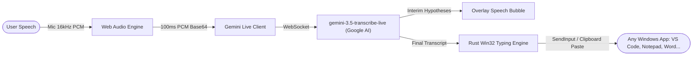

# VoiceType 🎙️⚡

> **Superfast, lightweight, system-wide Voice Typing anywhere on PC powered by Gemini Live API (`gemini-3.5-transcribe-live`), Rust, and Tauri v2.**


---

## ✨ Features

- **Type Anywhere in PC Software**:
  - Automatically types or pastes transcribed speech into **whatever application currently has cursor focus** (VS Code, Notepad, Discord, MS Word, Slack, Chrome, terminal, chat boxes, anywhere on Windows!).
  - **Instant Fast Paste (Recommended)**: Sub-millisecond clipboard injection + `Ctrl+V` with automatic previous clipboard restoration.
  - **Typewriter Simulation**: Character-by-character native Unicode keyboard injection (`KEYEVENTF_UNICODE`).
  - **Copy Only**: Transcribes and copies to clipboard without direct typing.

- **Powered by Gemini Live API (`gemini-3.5-transcribe-live`)**:
  - Connects over low-latency WebSockets directly to Google's real-time streaming speech-to-text pipeline.
  - **Dual Streams**:
    - **Interim Hypotheses**: Real-time speculative subtitles that update as you speak.
    - **Finalized Transcripts**: Cleaned, authoritative transcription committed with smart punctuation.
  - **Smart vs. Verbatim Modes**:
    - `SMART`: Disfluency removal ("um", "uh"), self-corrections, smart capitalization, structured numbers & lists.
    - `VERBATIM`: Literal word-for-word transcript.
  - **Hybrid VAD (Voice Activity Detection)**: Zero-latency turn finalization via client-side silence detection.
  - **Custom Vocabulary Biasing**: Provide technical jargon, brand names, or code syntax (e.g. `Gemini, Tauri, Rust, Kubernetes, PostgreSQL`).
  - **Language Auto-Detection & Hints**: Automatic detection across 70+ languages, or explicit BCP-47 language biasing.

- **Floating Draggable Mic Board (Overlay)**:
  - Stays **Always on Top** (`alwaysOnTop: true`), frameless and transparent.
  - **Non-Activating Window (`WS_EX_NOACTIVATE`)**: Clicking or dragging the mic board never steals keyboard focus from your active document or code editor!
  - **60 FPS Audio Waveform Visualizer**: Real-time frequency bar animations that react to your voice.
  - **Live Interim Preview Bubble**: Floating translucent badge showing speech hypotheses as words form.
  - **Compact Mini Orb Mode**: Collapse the overlay into a discrete 54px floating orb with 1 click.
  - **Remembers Position**: Drag it anywhere across multiple monitors; position persists across reboots.

- **System-Wide Global Hotkey**:
  - Default shortcut: `Ctrl+Alt+V` (customizable to `Alt+Space`, `Ctrl+Shift+Space`, etc.).
  - Toggle voice typing from anywhere without touching your mouse!

- **Acoustic Feedback Chimes**:
  - Zero-latency synthesized audio tones for mic Start, Stop, and Typing confirmation using Web Audio API.

- **History & Diagnostics Log**:
  - Timestamped history of all transcriptions with 1-click **Copy** and **Re-type** buttons.
  - Real-time connection latency (ms) and total word counter.

---

## 🚀 Architecture



---

## 🛠️ Getting Started

### Prerequisites
- Node.js >= 18
- Rust and Cargo (`rustc >= 1.78`)
- A [Gemini API Key](https://aistudio.google.com/app/apikey) from Google AI Studio

### 📦 Installable Executable (Recommended)
You can directly run or distribute the ready-to-use Windows installer:
- **`VoiceType-Setup.exe`** (located at `d:\Voice\VoiceType-Setup.exe`, ~1.9 MB)
- **`VoiceType-Setup.msi`** (located at `d:\Voice\VoiceType-Setup.msi`, ~2.9 MB)

Double-click `VoiceType-Setup.exe` to run the setup wizard. It automatically:
- Installs VoiceType to your Windows applications
- Creates Start Menu and Desktop shortcuts
- Provides a clean uninstaller in Windows Settings / Apps

### Running in Development
```bash
# Clone or navigate to the directory
cd d:/Voice

# Run via npm script
npm run tauri dev
```

### Building the Release Executable
```bash
# Build frontend assets
npm run build

# Build standalone Windows executable
cd src-tauri
cargo build --release
```
The compiled binary will be generated at `src-tauri/target/release/app.exe`.

---

## ⚙️ Configuration & Options

| Setting | Default | Description |
| :--- | :--- | :--- |
| **API Key** | Local Storage | Your Google Gemini API Key |
| **Model** | `gemini-3.5-transcribe-live` | Real-time streaming STT model |
| **Mode** | `SMART` | `SMART` (cleaned & punctuated) or `VERBATIM` |
| **Typing Method** | `Fast Paste` | Instant clipboard paste or Typewriter simulation |
| **Trailing Space** | `true` | Automatically append space after speech |
| **Sound Feedback** | `true` | Synthesized start/stop/typed chimes |
| **Global Hotkey** | `Ctrl+Alt+V` | System-wide listening toggle |
| **Language** | `Auto-detect` | Auto-detect or specific BCP-47 hint |
| **Custom Vocab** | Code & Tech terms | Speech biasing words/phrases |

---

## 📜 License
MIT License
